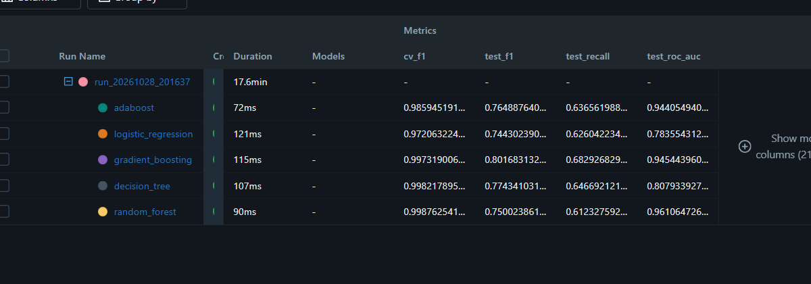
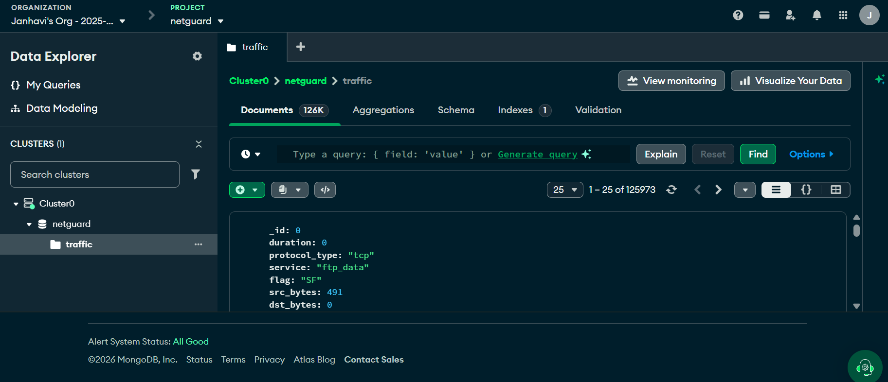
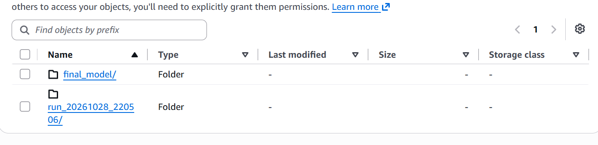
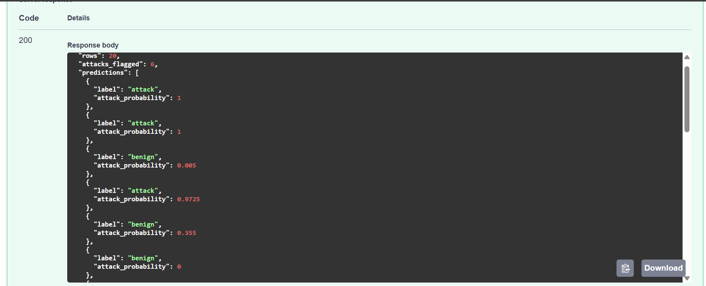

# NetGuard: Network Intrusion Detection Pipeline

An end to end MLOps pipeline that ingests network flow records, validates them, trains and compares five classifiers, tracks every run in MLflow, and serves the best model through a FastAPI service. Containerised with Docker, with optional MongoDB ingestion and S3 artifact sync.

## Pipeline

```
MongoDB / CSV -> ingestion -> validation -> transformation -> training (5 models) -> promotion -> S3 sync
                                                                    |                    |
                                                                  MLflow            final_model/ -> FastAPI
```

| Stage | File | What it does |
|---|---|---|
| Ingestion | `netguard/ingestion.py` | Reads from MongoDB (or CSV fallback), maps labels to attack/benign, stratified train/test split |
| Validation | `netguard/validation.py` | Schema and dtype checks, missing-value limits, class presence, train-vs-test drift (KS test for numeric, chi-square for categorical) |
| Transformation | `netguard/transformation.py` | Median impute + scale for numeric, mode impute + one-hot for categorical |
| Training | `netguard/trainer.py` | Grid-searches Random Forest, Decision Tree, Gradient Boosting, Logistic Regression, AdaBoost; logs each as a nested MLflow run |
| Promotion | `netguard/pipeline.py` | New model replaces `final_model/` only if its held-out F1 beats the current champion |
| Storage | `netguard/storage.py` | Uploads run artifacts and the promoted model to S3 |
| Serving | `app.py` | `/predict`, `/predict/csv`, `/model-info`, `/train`, `/train/status`, `/health` |

## Design decisions

- **No leakage in CV.** The preprocessor sits inside each `Pipeline`, so scaling and imputation statistics are learned per fold, never from validation data.
- **Winner chosen on CV, reported on held-out.** Selecting on the test set would inflate the reported number, so the test split is only used for reporting.
- **Champion/challenger promotion.** A retrain that performs worse does not overwrite the deployed model.
- **Optional dependencies.** Without `MONGO_URI`, `S3_BUCKET` or a remote MLflow URI the pipeline runs fully locally (CSV + SQLite MLflow store).

## Quick start

```bash
pip install -r requirements.txt
python scripts/make_synthetic_data.py      # smoke-test data only, NOT real traffic
python main.py                             # runs all stages, promotes a model
uvicorn app:app --port 8000                # http://localhost:8000/docs
```

Example request:

```bash
curl -X POST localhost:8000/predict -H 'Content-Type: application/json' -d '{"records":[
 {"duration":0.1,"src_bytes":20,"dst_bytes":30,"count":400,"srv_count":300,
  "serror_rate":0.95,"rerror_rate":0.02,"same_srv_rate":0.9,"logged_in":0,
  "protocol_type":"tcp","service":"http"}]}'
```

## Using a real dataset

The bundled generator is only for smoke tests.

**NSL-KDD (ARFF):** convert the files and train on the official split.

```bash
python scripts/arff_to_csv.py --train KDDTrain+.arff --test KDDTest+.arff
NETGUARD_CONFIG=config/config.nslkdd.yaml python main.py
NETGUARD_CONFIG=config/config.nslkdd.yaml uvicorn app:app --port 8000
```

The converter infers numeric vs categorical columns, maps `class` (`normal` / `anomaly`) to benign / attack, and writes `config/config.nslkdd.yaml`. With `--test`, `KDDTest+` is used as the fixed test set instead of a random split. That split is much harder (its attack types differ from training), so expect lower scores than a random split of `KDDTrain+`. Report which one you used.

**Other datasets:** put a CSV at `data/raw/traffic.csv` and edit `config/config.yaml` (`data.target`, `data.benign_labels`, `features.numeric`, `features.categorical`).

## MongoDB, S3, MLflow / DagsHub

Copy `.env.example` to `.env` and fill what you use.

```bash
python scripts/push_to_mongo.py --replace  # CSV -> MongoDB (needs MONGO_URI)
python main.py                             # now ingests from MongoDB
```

- **S3:** set `S3_BUCKET` plus AWS credentials; every run's artifacts and the promoted model are uploaded.
- **DagsHub:** set `MLFLOW_TRACKING_URI=https://dagshub.com/<owner>/<repo>.mlflow` and the tracking username/password.
- **Local MLflow UI:** `mlflow ui --backend-store-uri sqlite:///mlflow.db`

## Docker

```bash
docker build -t netguard-ids .
docker run -p 8000:8000 --env-file .env -v "$PWD/final_model:/app/final_model" netguard-ids
```

## Tests

```bash
pip install -r requirements-dev.txt
pytest tests
```

Covers the full pipeline, promotion logic, validation failures, MongoDB ingestion (mocked), S3 sync (mocked) and the API.

## Results

Evaluated on the official NSL-KDD split: trained on `KDDTrain+` (125,973 rows), tested on `KDDTest+` (22,544 rows). The best model was selected on cross-validation F1 and reported on the held-out test file.

| Model | CV F1 | Test F1 | Test recall | Test ROC-AUC |
|---|---|---|---|---|
| Random Forest (selected) | 0.9988 | 0.7500 | 0.6123 | 0.9611 |
| Decision Tree | 0.9982 | 0.7743 | 0.6467 | 0.8079 |
| Gradient Boosting | 0.9973 | 0.8017 | 0.6829 | 0.9454 |
| Logistic Regression | 0.9721 | 0.7443 | 0.6260 | 0.7836 |
| AdaBoost | 0.9859 | 0.7649 | 0.6366 | 0.9441 |



CV scores are near 1.0 because cross-validation splits inside `KDDTrain+`, while `KDDTest+` contains attack types absent from training. The selected model has 0.97 precision and a 2.7% false positive rate, but 0.61 recall on the unseen attack types.

## Deployment proof

**MongoDB Atlas:** 125,973 NSL-KDD training records stored and ingested by the pipeline.



**AWS S3:** each run's artifacts and the promoted model are synced to a bucket.



**Docker:** the model is served from a container, with `/health` confirming the model loaded.

